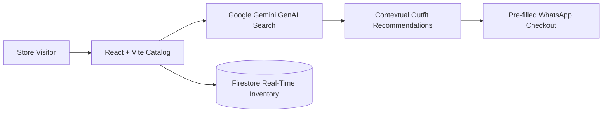

# Sumera Collections

D2C ethnic wear e-commerce storefront featuring real-time product discovery, Firestore catalog synchronization, and Google Gemini API assisted search.

Live deployment: https://sumeeracollections.vercel.app

---

## Architecture Flow



---

## Overview

Sumera Collections is a responsive web application designed for boutique fashion retail. It replaces static inventory listings with dynamic catalog browsing, category filtering, and direct customer WhatsApp inquiry routing.

---

## Core Capabilities

- Product catalog with real-time Firestore database synchronization.
- Filter by occasion, fabric, size, and price range.
- Google Gemini API integration for natural language outfit recommendations.
- Direct WhatsApp order button with pre-filled item SKU, size, and pricing.
- Optimized mobile-first layout with smooth touch transitions.

---

## Tech Stack

- Frontend: React, Vite, Tailwind CSS, TanStack Query, Lucide Icons
- Database and Auth: Google Firebase (Firestore, Firebase Storage)
- AI Layer: Google GenAI SDK (@google/genai)
- Hosting: Vercel Edge Network

---

## Local Development

Prerequisites: Node.js 18 or higher, npm.

```bash
# 1. Clone the repository
git clone https://github.com/MuhammadMinhaj229/sumera_collections.git
cd sumera_collections

# 2. Install dependencies
npm install

# 3. Configure environment
cp .env.example .env
```

Add your Firebase and Gemini credentials to `.env`:
```env
VITE_FIREBASE_API_KEY=your-api-key
VITE_FIREBASE_AUTH_DOMAIN=your-auth-domain
VITE_FIREBASE_PROJECT_ID=your-project-id
VITE_FIREBASE_STORAGE_BUCKET=your-storage-bucket
VITE_FIREBASE_MESSAGING_SENDER_ID=your-sender-id
VITE_FIREBASE_APP_ID=your-app-id
VITE_GEMINI_API_KEY=your-gemini-key
```

```bash
# 4. Start local development server
npm run dev
```

---

## How to Deploy to Vercel

1. Push your changes to GitHub.
2. In the Vercel dashboard, import `sumera_collections`.
3. Set the build parameters:
   - Framework: Vite
   - Build command: `npm run build`
   - Output directory: `dist`
4. Add all environment variables from `.env`.
5. Click Deploy.

---

## Author

Mohammed Minhaj Mahmood  
Portfolio: https://mohammed-minhaj.netlify.app/  
Email: minhajmuhammad229@gmail.com
